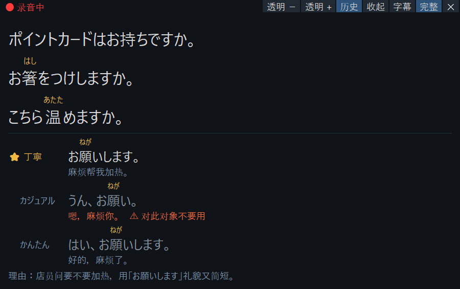

# jsc_live — 实时日语字幕 + 接话建议

开着它和日本人说话（或看日语视频）时，屏幕下方会出现一个小窗口：

- **上半部分是字幕**：对方说的日语，难的汉字上面标假名；
- **下半部分是「怎么接话」**：对方说完一段话、停下来之后，给出 3 种回复；有【字段】时先填写再说：
  - 丁寧：礼貌版，对上司、老师、店员说；
  - カジュアル：朋友版；
  - かんたん：紧张时的保底版。
  
  标 ⭐ 的是模型根据对方身份和用语推荐的那条；标 ⚠ 的表示「这条别对这个人说」。模型漏选时，程序仍会按推荐理由补上；理由也没说清时补成丁寧。

  对方连续说好几句时，建议会等他停下来，再针对这一整段给出；中途不会每句都刷新。字幕区保留最近 5 句，可以回看。

旁边还有一个**字幕历史**窗口：这次用到现在的所有字幕都在里面，可以往回翻；用鼠标选中一个词，下面马上显示读音，约 1 秒后显示这个词在这句话里的中文意思。

想留下这次的录音和字幕复习时，用「录音版」启动，会**存档**（录音 + 字幕 + 建议）。



## 怎么用

### 第一次使用前（只做一次）

1. 确认装过依赖（已经装好的话跳过）：在 Anaconda Prompt 里运行
   ```
   conda activate jsc
   pip install -r D:\ClaudeProject\japanese-speaking-coach\app\requirements.txt
   ```
2. 想要「接话建议」的话，在 `japanese-speaking-coach` 文件夹里放一个名字**正好叫 `.env`** 的文件（不是 `.env.txt`。记事本保存时要把「保存类型」选成「所有文件」），内容是三行：
   ```
   LLM_API_KEY=你的 DeepSeek key
   LLM_BASE_URL=https://api.deepseek.com
   LLM_MODEL=deepseek-flash
   ```
   不放这个文件也能用字幕，只是没有建议。
3. 想让回答参考课程笔记、文章、工作文档或个人背景，可以先建立外部资料文件夹：
   ```powershell
   .\jsc-live.bat --init-materials
   ```
   命令会显示文件夹位置，默认在 `%LOCALAPPDATA%\JapaneseSpeakingCoach\materials`，和代码分开。把 UTF-8 的 `.md` / `.txt` 文件放进去即可；一个主题一段、加清楚的标题更容易查到，修改后重启应用。
   - 不放资料也能用字幕和接话建议；需要补充的具体情况应留成【字段】，请先填写再说。
   - 开启建议后，软件会在本机找相关片段，**把命中的片段随问题发给 API**。只放愿意发送的资料；不会自动扫描你的课堂存档。
   - 回答用了资料时，理由会显示文件名与行号；点工具栏「资料」可查看本轮实际发送的片段。检索命中和模型声明引用会分别标记。
   - 检索和模型都可能漏掉信息或引用不当；这是参考回答，仍需结合当前谈话判断。

有自己的资料文件夹时：

```powershell
.\jsc-live.bat --materials "D:\我的资料\日语课"
```

从旧版 `profile.md` 导入时：

```powershell
.\jsc-live.bat --import-profile .\profile.md
```

这一步只复制到外部资料区，完成后退出；原文件保留，目标同名文件已存在就停止，不会覆盖。正常启动已不自动读取仓库里的 `profile.md`。个人背景只是资料的一种，也可以直接放入课程说明、会议笔记或操作手册。

### 每次使用

`japanese-speaking-coach` 文件夹里有两个启动脚本，双击即可：

| 脚本 | 用途 |
|---|---|
| `jsc-live.bat` | **普通版**：字幕 + 建议，**不录音** |
| `jsc-live-录音.bat` | **录音版**：同上，另外把这次的录音、字幕、建议存档；关闭窗口后自动打开这次的存档文件夹 |

两个都默认「给电脑正在播放的声音配字幕 + 建议」，适合看视频、网课、视频通话。

第一次启动要等十几秒加载识别模型（没下载过的话会先自动下载约 1.5 GB），窗口里会显示「モデル読み込み中…」，出现「聞き取り中」就可以开始了。

想识别**麦克风**（面对面说话）时，在 PowerShell 里运行（要录音就把 `jsc-live.bat` 换成 `jsc-live-录音.bat`）：

```powershell
D:\ClaudeProject\japanese-speaking-coach\jsc-live.bat --source mic --suggest
```

知道对方是谁时，可以告诉它，⭐ 会更准：

```powershell
D:\ClaudeProject\japanese-speaking-coach\jsc-live.bat --source mic --suggest --partner 上司
```

`--partner` 后面可以写 上司 / 老师 / 店员 / 朋友 等。

### 窗口操作

字幕窗顶上一排按钮：

| 按钮 | 作用 |
|---|---|
| 透明 − / 透明 + | 调透明度（也可以按住 Ctrl 滚鼠标滚轮） |
| 历史 | 打开 / 关闭字幕历史窗口 |
| 资料 | 查看本轮发给 API 的参考片段和回答声明引用的出处 |
| 收起中文 / 展开中文 | 收起或显示中文意思与理由；⚠ 警告一直保留 |
| 收起 | 只留这一排按钮，字幕和建议都不显示 |
| 字幕 | 只显示字幕，不显示建议 |
| 完整 | 字幕 + 建议 |
| ✕ | 退出（右键、Esc 也可以） |

- 拖动：移动窗口；鼠标滚轮：调字号。
- 左上角「● 录音中」：用录音版启动时显示，表示这次正在存档（见下面「存档」）。
- 白字是说完的日语句子（保留最近 5 句）；浅灰色是正在说、还没说完的句子（说完会更正）。
- 「ご視聴ありがとうございました」这类视频片尾套话，多半是杂音被识别模型「编」出来的，程序会直接丢掉不显示。
- 建议区显示「…」：正在生成。
- 显示「タイムアウト」：3 秒内没生成出来；之后再到的建议会标「遅延」。

### 字幕历史和查词

- 历史窗口可以自由拖动、调整大小；点它右上角的关闭只是隐藏，字幕窗上的「历史」可以再打开。
- 选中一个词（或一小段），底部显示：选中的文字【读音】、辞书形（如 恥ずかしかった → 恥ずかしい），以及这个词在这句话里的中文意思。
- 读音在本机查，立刻出来；意思要问 DeepSeek（需要 `.env`），约 1 秒。查过的词会记住，再查不花时间。
- 历史里只记字幕，不记建议（程序不知道你实际说了哪一条，记下来反而乱）。

### 存档

用 `jsc-live-录音.bat` 启动时，会在 `japanese-speaking-coach\logs\sessions\` 下新建一个以日期时间命名的文件夹（普通版 `jsc-live.bat` 不存档）：

| 文件 | 内容 |
|---|---|
| `transcript.txt` | 带时间的全部字幕，如 `[03:15] 今日はその中で…` |
| `stream.wav` | 这次听到的全部声音 |
| `clips\` | 每句话单独的音频 + `transcripts.tsv` |
| `suggestions.jsonl` | 每次的建议和耗时（开了建议时） |
| `meta.json` | 来源、模型、开始结束时间、句数 |

`logs\sessions\index.tsv` 是总目录，每次使用一行（日期、分钟数、句数、文件夹名）。存档只在你电脑上，不会提交到 GitHub。视频通话时录下的是对方的声音，最好让对方知道。

### 没反应怎么办

- **直接打 `python ...` 没反应**：那个 `python` 是 Windows 自带的占位程序，不是装好依赖的 Python。请用上面的 `jsc-live.bat`。
- **双击后黑窗口一闪就关**：一般是出错了。脚本出错时会停住等你按键，把那段报错截图给我。
- **字幕出来了但没有建议**：检查 `.env` 的文件名和三行内容。

## 请你帮忙做的测试：真人说话 / 真实视频

字幕已有课堂和真实录音测试；本轮外部资料问答与界面调整使用虚构文档、文字和合成语音验证，还需要实际通话体验确认。

**做法**：

1. 双击 `jsc-live.bat`，放一段日语视频（日剧、YouTube 的日常对话都行），看 3–5 分钟。
2. 用上面麦克风那条命令，自己对着麦克风说，或者请朋友说，3–5 分钟。

**留意这几点**（记下印象最深的 2–3 个例子就够）：

1. **字幕**：说完一句后多久出来？有没有一句被切成两半、或两句粘在一起？错字多不多？
2. **建议出来得快不快**：大多在 3 秒内吗？「タイムアウト」/「遅延」多吗？
3. **建议能不能用**：⭐ 那条你敢直接说出口吗？有没有不自然、或礼貌程度不对的？
4. **跟不跟得上**：对方连着说好几句时，建议是不是总慢一拍、来不及看？
5. **最想先改的一件事**是什么？

**做完后**告诉我两样东西：

- 上面几点的印象；
- `japanese-speaking-coach\logs\` 里最新那个 `live-…jsonl` 文件。里面记录了每句识别出的文字、建议和耗时。因为有你说过的话，它不会被提交到 GitHub，我只在你电脑上读。

---

## 给开发者看的部分

### 处理流程

```
音频采集 (soundcard: 麦克风 / WASAPI 回采)
  → 分句 (能量 VAD，自适应噪声底)
  → 识别 (faster-whisper + Whisper large-v3-turbo，GPU float16；可用 --model 换回 kotoba-whisper-v2.0)
  → 注音 (MeCab/fugashi + UniDic 读音，按 N5–N4 基础汉字表分级)
  → 字幕窗 (tkinter Canvas 手动排 ruby)
  → 接话建议 (OpenAI 兼容 API，规则复用 skill/SKILL.md 的 A 模式；后台线程，不阻塞字幕)
```

- 识别在本机显卡上跑，音频不出电脑。接话建议要联网，发送文字：识别出的这一段、之前的几句、`--partner`，以及从外部资料区检索出的相关片段。
- DeepSeek 默认关闭「思考」模式（开着首字要多等约 2 秒）；用别的服务时，可以在 `.env` 加一行 `LLM_EXTRA_BODY={...}`（JSON，原样并入请求）。
- 每句耗时分三段记录在 `logs/live-*.jsonl`：识别、API 往返、渲染。控制台也会打印 `[suggest #n] asr … | api … | render …`。

### 全部参数

直接用 Python 运行时：先 `conda activate jsc`，再在 `app` 目录下运行 `python -m jsc_live …`（直接运行时默认存档）。两个 `.bat` 会把参数原样传过去，`jsc-live.bat` 还会自动加上 `--no-record`。

| 参数 | 说明 |
|---|---|
| `--source loopback` | 电脑正在播放的声音（不写参数时的默认） |
| `--source mic` | 麦克风 |
| `--source file --file a.wav --realtime` | 用 WAV 文件模拟实时输入 |
| `--suggest` | 打开接话建议（需要 `.env`） |
| `--partner 上司` | 对方是谁，影响 ⭐ 和 ⚠ |
| `--materials 文件夹` | 指定外部参考资料区；不指定就用用户数据目录 |
| `--init-materials` | 建立资料区并显示路径，然后退出，不调用 API |
| `--import-profile 文件` | 把明确指定的旧资料复制到资料区，保留原文件且不覆盖目标，然后退出 |
| `--suggest-timeout 3` | 几秒没到算超时 |
| `--turn-gap 0.8` | 对方停下来后再等几秒才出建议（在 0.6 秒分句停顿之外）；调小更快，调大更不容易把一段话切开 |
| `--history 5` | 字幕区保留几句 |
| `--font-size 16` | 字号（也可以在窗口上用滚轮调） |
| `--no-record` | 不存档（`jsc-live.bat` 自动加上；直接用 Python 运行时默认存档） |
| `--mixed-chinese` | （暂时搁置）同时识别中文句子，灰色显示、不出建议，每句慢约 0.2 秒 |
| `--no-history` | 不打开字幕历史窗口 |
| `--device 名称` | 指定麦克风/扬声器，名称用 `--list-devices` 查 |
| `--furigana graded/all/none` | 分级注音（默认，N5–N4 汉字不注）/ 全部注音 / 不注音 |
| `--no-partial` | 只显示说完的句子 |
| `--no-window` | 不开窗口，只在控制台输出 |
| `--end-silence 0.6` | 停顿多少秒算一句话结束 |

### 实测（RTX 5060 Laptop 8 GB，合成语音）

| 测试 | 结果 |
|---|---|
| 一句话说完到字幕出现 | 约 0.6 秒停顿判定 + 0.22–0.29 秒识别 |
| 20.8 秒、5 句的对话 | 5 句分句正确；识别错误 1 处（十時 → 届き） |
| 系统声音回采 | 与文件输入结果一致 |
| 接话建议，一问一答 10 句（deepseek-flash） | 最后一句字幕 → 建议显示：中位数 2.43 s，最大 2.63 s；其中等待停顿 0.82 s、API 往返 1.55 s（首字 0.85 s）、渲染 72 ms（`tests/live_suggest/e2e-dialogue-*`） |
| 接话建议，独白 3 段 11 个片段 | 只请求 3 次，每次回应整段；2.49 / 2.65 / 3.09 s（`tests/live_suggest/e2e-monologue-*`） |

单元测试：在 `japanese-speaking-coach` 目录下运行 `python -m unittest discover -s tests`，不需要显卡和网络。2026-10-26 本轮共166项：165通过，1项因系统不允许创建符号链接而跳过，另有链接属性和越界路径测试通过。

开发评测默认在后台隐藏窗口，避免挡住正在使用的其它软件。`tools/e2e_suggest.py` 和 `tools/benchmark_overlay.py` 只在显式加 `--show-window` 时显示测试窗；Windows 下该窗口会鼠标穿透、不抢焦点。后台的 Canvas 完成耗时不是实际可见显示延迟，两种结果会分别标记。截图还须显式指定输出路径；提前结束的运行会标记未完成并返回非零退出码。

通用资料链路的公开合成语音检查：`python tools/e2e_suggest.py --scenario references --materials tests/fixtures/materials/general/data`。这会使用四份虚构文档，不读取使用者的默认资料区。

### 已知限制

- 有背景音乐、多人同时说话时，分句会不准。
- 识别偶尔会把读音相近的词认错；注音跟着识别结果走，认错的词，注音也是错词的读音。
- ⭐ 偶尔不按规则选；上文有时会串到下一句的建议里（详见 `docs/decisions.md` D-012）。
- 没有资料的个人情况应由你补全【字段】。模型的事实约束已有固定样本评测，但尚不能保证所有问法都不误答；不要把具体示例或未经确认的肯定/否定直接当成自己的事实。
- 只在 Windows 上测试过（系统声音回采依赖 WASAPI）。
