# Japanese Speaking Coach — リアルタイム字幕と返答候補

> 画面は公開の架空データまたはTTS音声による再生・個人情報なし（撮影条件は [`docs/images/README.md`](images/README.md)）。

## できること

会話中、画面下の小さなウィンドウが次の 3 つを支える。

1. **聞き取る**：PC で再生中の音声（ビデオ通話・動画）かマイクを GPU 上で文字起こしし、難しい漢字にだけふりがなを付ける。
2. **返す**：話し終えた発言に対し、丁寧／カジュアル／かんたんの3候補と推奨⭐を出す。【欄】があれば話す前に補う。Skillの適用可能な会話規則をアプリ用に組み立てる。外部フォルダーの授業・会議・記事・マニュアル等を検索し、関連する断片だけをAPIへ送り、回答理由に出典を表示する。
3. **覚える**：字幕履歴で選んだ語の読みと文脈上の意味を確認できる。録音版は音声・字幕・候補・成功した単語検索を保存し、あとからローカルの復習ページとAnki用TSVへ書き出せる。

資料フォルダーは「资料」ウィンドウから選択・再読込でき、選択を記憶する。読込はバックグラウンドで行い、生成中の回答は元の資料と出典を保持する。

復習は字幕ツールバーの「复盘」またはjsc-review.batから、保存済みの会話を選んで書き出す。音声認識やAPIを起動せず、結果を開く操作は利用者が行う。

必要ならローカル多言語検索を明示的に有効化できる（D-030）。資料の言い換え・他言語表現を探し、長い段落も小窓に分けて検索する。D-031では「资料→多语言查找…」から準備・切替でき、選択を記憶する。初回はキーワード検索、ダウンロードは明示クリック時だけ。

## 画面

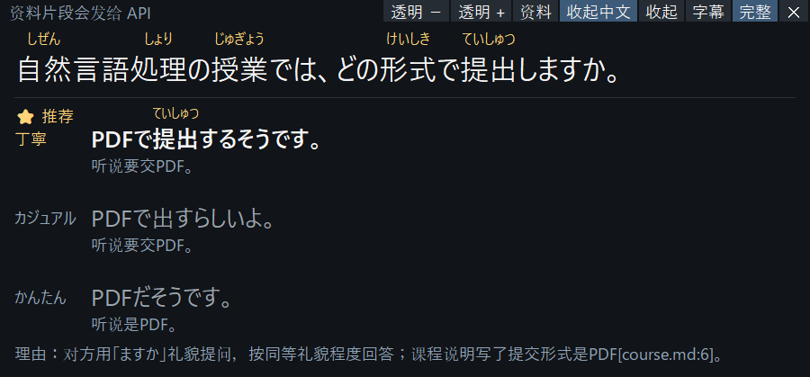

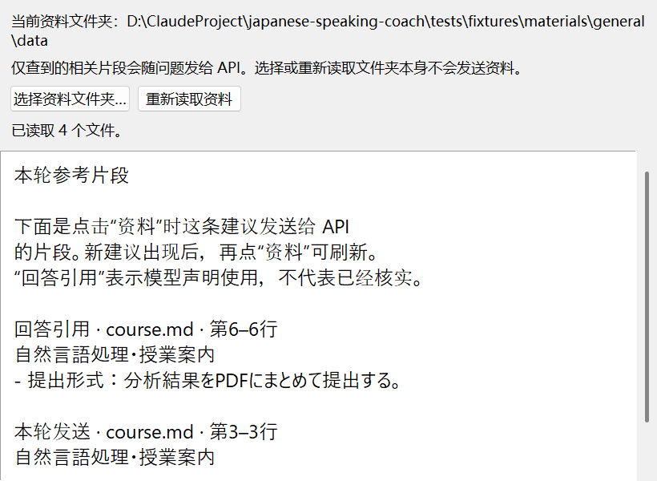

上の3枚は2026-10-26の保存済みTTS結果・参考片段を現UIへ再表示したもの。APIや音声認識を再実行した画像ではない。

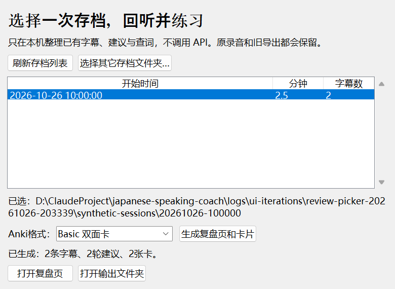

復習画面は2字幕・2回答・2カードの公開架空データを使用し、TTS再生やAPI測定ではない（D-028）。以下は2026-10-25の旧画面。

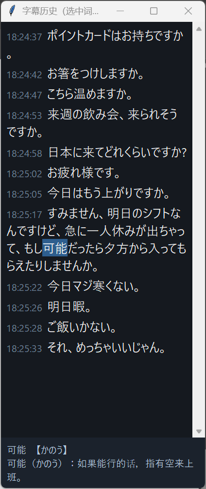

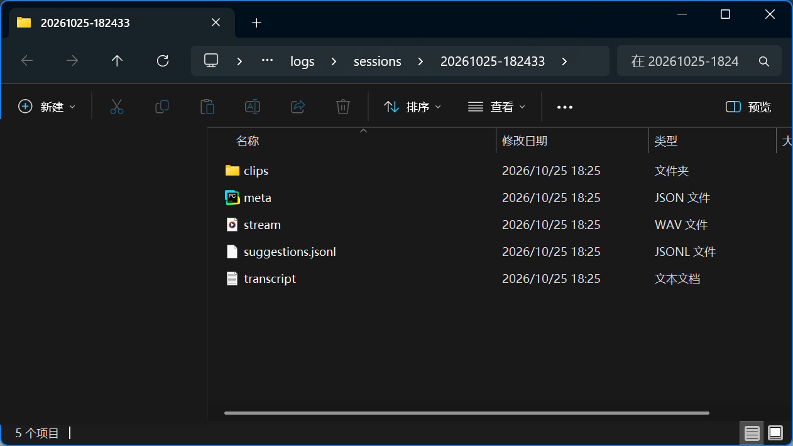

動画：[`images/live-demo.webm`](images/live-demo.webm)（26 秒）

## 現在の検証（2026-10-26）

- 通用文書の固定6問：資料あり5問は5/5で有効な出典を表示、資料なし1問は検索結果・引用とも0。これは小規模な接続確認で、一般的な正答率ではない。
- 4問のTTS実行：字幕から**非表示Canvasの完了**までp50 2558ms、p95 2730ms。4/4で事前検索キャッシュを利用。画面に見えるまでの速度や真人の会話での合格を意味しない。
- 復習用の架空アーカイブ：2字幕・2回答・2カードを書き出し。古いTTSアーカイブは4字幕・4回答・0カードで、保存されていない単語検索を補造しない。
- 単体テスト312件（311成功、Windowsのリンク作成権限による1件スキップ）。設計記録D-001〜D-036。

追加の検索実験（D-029）：公開資料の言い換え・他言語による16問で、必要な断片の取得はBM25の5/16からローカル多言語モデルの16/16に増えた。一方、別の既存10問では答えのない質問への空返却が3/3から1/3に減ったため、アプリの既定検索は変更していない。これは検索の小規模実験で、回答の正答率ではない。[モデル・条件・制約](retrieval-prototype-20261026.md)。

根拠：`tests/live_suggest/references-eval-20261026-171350-165202.json`、`e2e-references-20261026-171615.jsonl`、`review-export-20261026-195422.json`。

D-030の追加検証：47の固定質問に含まれる36の目標範囲を取得。これは回答正答率ではなく、資料に答えがない11問中、空返却は4問だけ。6問の回答段階チェックでは既知3問の推奨回答が期待事実を含む一方、不明3問中1問の表現と簡単版の条件省略が未解決。4段TTSは非表示Canvas p95 2752.5ms、4/4事前検索キャッシュ利用。[条件と制約](local-semantic-materials.md)。

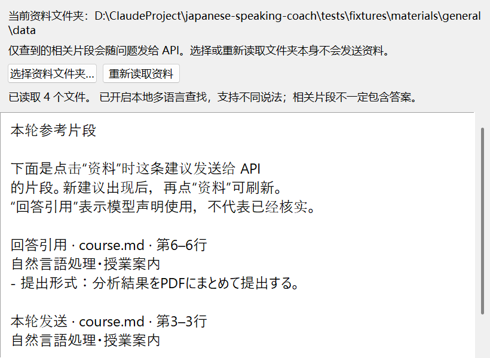

この画面は現索引の状態と保存済みTTS出典の再表示。新しい生成回答の画像ではない。

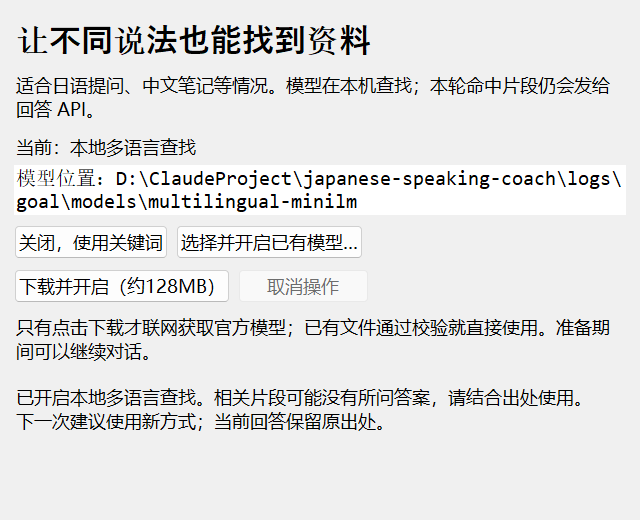

D-031：公開資料と実際の本機モデル、仮の設定ファイルで操作を確認。実ユーザー設定は変更していない。47問の資料JSONはD-030と同一で、新たな生成APIや速度測定ではない。

## 以前の可視実行（2026-10-25・TTS10文・RTX 5060 Laptop）

| 区間 | p50 | p95 |
|---|---|---|
| 音声認識（large-v3-turbo） | 258 ms | 333 ms |
| API 往復（deepseek-flash） | 1565 ms | 1986 ms |
| 描画 | 71 ms | 102 ms |
| 最後の字幕 → 返答候補が出るまで | 2.46 s | 2.90 s |

この旧実行では話し終えてから最初の字幕まで0.81s。現在版の可視遅延として転用しない。D-023の後続10問ではp95 3586msとなり、安定した3秒以内の可視表示はまだ未達。

## できないこと（正直に）

- 数字は TTS 音声での測定。作者本人は実際の動画と 89 分のオンライン授業で使ったが、第三者の試用と日本語母語話者のレビューはまだ。
- ⭐の明示選択はD-021固定文字集で60/60になったが、未知の場面で常に適切とは限らない。返答・引用の意味の正しさはモデルに依存する。
- 資料はUTF-8のmd/txt、Wordの本文・単純な表、文字付きPDFに対応。Wordの画像・ヘッダー・コメント・複雑な表、PDFのOCRは対象外。キーワード検索には言い換え・他言語表現の取りこぼしがある。編集後は「重新读取资料」で更新する。引用位置が有効でも、意味が正しい保証にはならない。
- 復習は既存記録の整理で、ユーザーが実際に言った返答の推測や新しい自動採点はしない。Ankiデスクトップへの実インポートと学習効果は未検証。
- 中国語が混ざる会話は保留中。Windows のみ。

## 次にやること

復習入口を見つけやすくする、資料検索の言い換え対応を改善する、可視表示の長い待ち時間を減らす、保存した実音声で認識を確認する、第三者による試用。開発用のウィンドウは既定で非表示、撮影時は画面外で自身だけを描く。

### Wordの資料から検索（D-032）

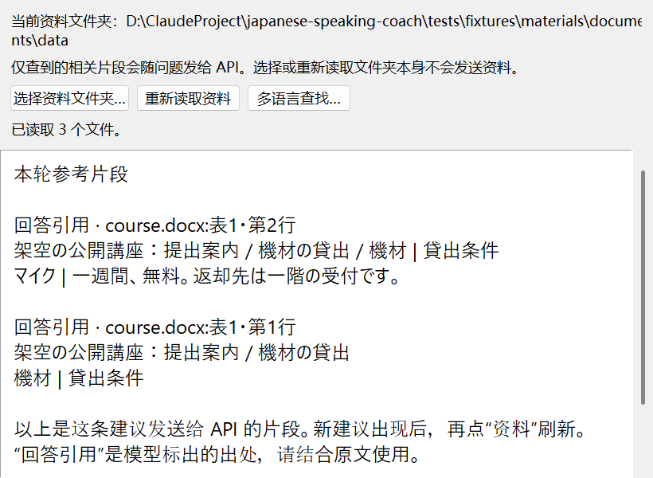

公開の架空Word 2件・固定10問で、該当箇所の取得は未対応0/10→キーワード9/10→本機多言語10/10。出典は本文段落・表の行で表示する。画面は検索結果と引用状態の合成表示で、生成APIは呼んでいない。回答の正答率・可視速度の測定ではない。旧47問の資料JSONは不変。制限と証拠：`docs/external-documents.md`、`tests/live_suggest/docx-stage-20261026.json`。

### PDFの資料とページ番号（D-033）

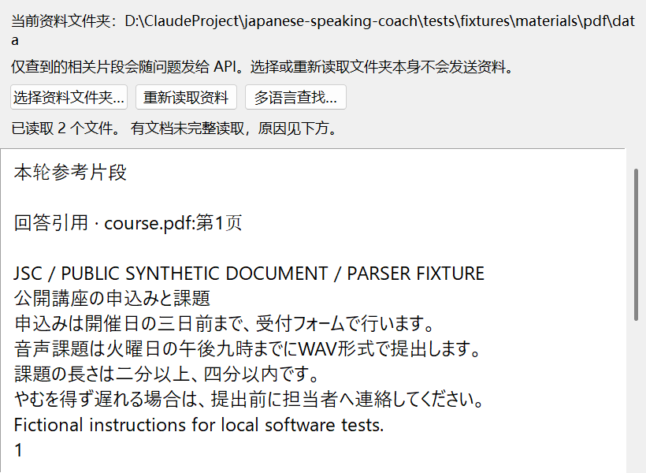

架空PDFの4文字ページ・10問で対象ページの取得は0/10→キーワード8/10→本機多言語9/10。日本語で昼食の有無を聞く質問は、中国語の説明をまだ取得できない。画像だけの1ページは文字なしと表示し、OCRや回答生成は行わない。画面は検索片段/引用状態の合成入力で、生成品質や可視速度の証拠ではない。旧57問の資料JSONは同一。PDF提取は非表示の子プロセスで、実測中の前面ウィンドウは変わらなかった。

### 資料の読み込み状況とキャンセル（D-034）

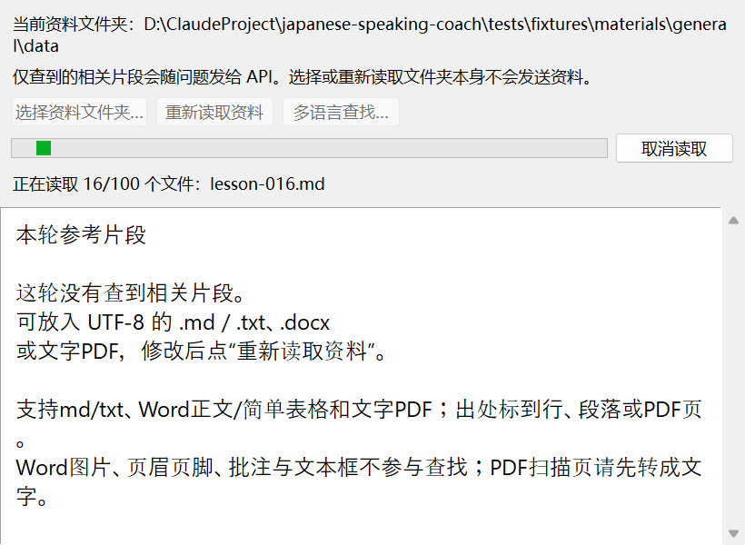

架空100ファイル・1600段落の末尾までの収録は16/100→100/100。識別子の10問は2/10→10/10で、自然な質問の正答率ではない。多言語索引の作成は約24秒、更新は進捗表示・取消に対応し、元の資料で会話を続けられる。起動時の待ち時間は未改善。67問の資料JSONは同一。画面は撮影用に進捗を一時停止した合成状態で、速度測定とは別。

### 資料のバックグラウンド起動（D-035）

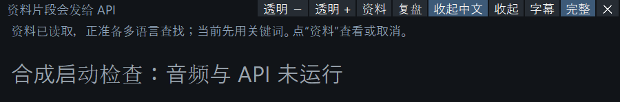

同じ100ファイルで、音声・APIを隔離したmain処理から画面外ウィンドウ構築まで22.33秒→0.36秒。キーワード資料は約0.92秒で使用可能、多言語資料がすべて準備できるまで約25秒。総索引時間の短縮ではなく、準備がウィンドウ作成を妨げなくなった。音声認識モデルの起動時間・実際の通話や可視速度は未測定。画面の文字は合成テスト状態。

### 長いPDF内の話題を分ける（D-036）

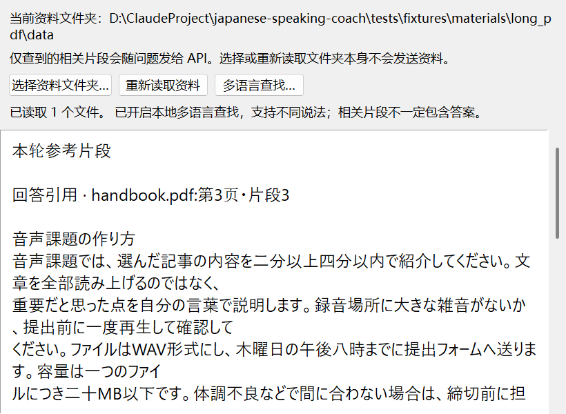

架空4ページ・16問で必要な事実の取得16/16を維持し、対象節の全文を含む取得は9/16→16/16。選択本文の平均は1371→882文字。版面の空行を使う前に原抽出文字と文字順を照合し、不一致なら元のページ抽出を維持する。元の短いPDF等67問の資料JSONは同一。これは検索文脈の評価であり、生成回答の正答率ではない。画面の引用状態は合成入力、生成APIなし。
