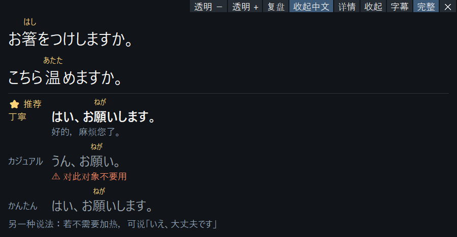
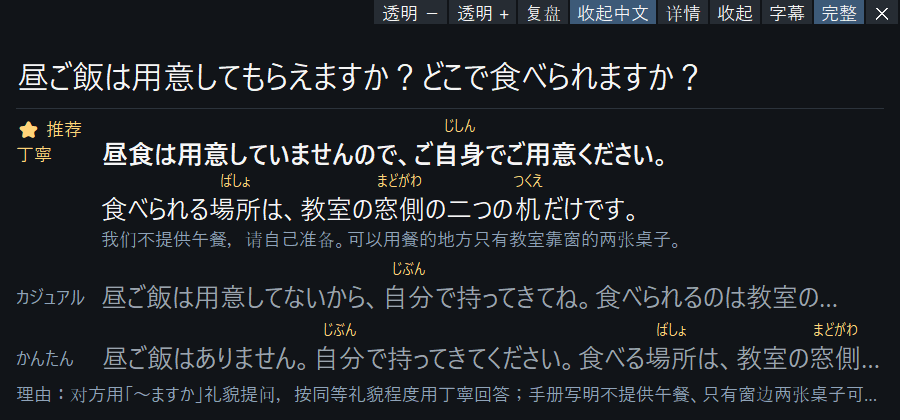

# Japanese Speaking Coach — 会話中の字幕と返答候補

> 画面・動画はすべて TTS 音声（Windows 標準音声）または公開の架空資料による実行です。人の会話の録音・個人情報は含みません。撮影条件は [`images/README.md`](images/README.md)。

## できること

日本語のビデオ通話やオンライン授業の最中に、画面下の小さなウィンドウが次の 3 つを支えます。

1. **聞き取る**：相手の日本語を GPU 上で文字起こしし、難しい漢字にだけふりがなを付けて表示します。
2. **返す**：相手が話し終えると、そのまま口に出せる返答を 丁寧／カジュアル／かんたん の 3 つ出し、相手と話し方から 1 つを ⭐ で推奨します。⭐ の 1 文目が結論で、太字で表示されます。行く・行かないのような選択は自然な答えを示し、もう一方の言い方を「另一种说法」に添えます。授業資料やマニュアルのフォルダーを指定すると、関連部分だけを参照して出典付きで答えます。
3. **覚える**：字幕の履歴で単語を選ぶと読みと文脈上の意味が出ます。録音版は会話を保存し、あとで復習ページと Anki カードを作れます。

## 画面

動画：[`images/showcase-demo.webm`](images/showcase-demo.webm)（25 秒、無音）

## 数字（2026-10-28、RTX 5060 Laptop GPU、すべて TTS／文字の評価）

| 項目 | 結果 |
|---|---|
| 最後の字幕 → 返答候補の表示（10 文） | p50 2.21 s ／ p95 2.50 s、10/10 が 3 秒以内 |
| 音声認識（large-v3-turbo） | p50 0.25 s |
| そのまま言える返答（20 文 × 2） | 102/102、⭐ が想定と一致 40/40、相手の言葉の丸写し 0/120 |
| 資料にもとづく回答の要点（架空資料 8 問） | 20/21 |

単体テスト 328 件。設計判断の記録 D-001〜D-041。

## できないこと（正直に）

- 数字は合成音声と文字の評価です。作者本人は実際の動画と 89 分のオンライン授業で使いましたが、最新版の実会話での確認、第三者の試用、日本語母語話者のレビューはまだです。
- 返答の質と速さは DeepSeek（deepseek-flash）に依存します。速さはこの数回の改善でほとんど変わっていません。
- 中国語が混ざる会話は保留中です。Windows のみです。

## 次にやること

最新版を実際のビデオ通話で試すこと、返答をさらに速くすること、第三者による試用。
